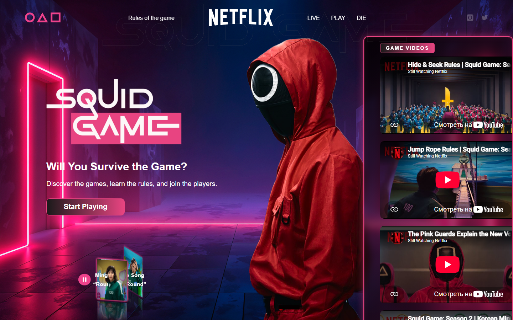

# Squid Game — browser game interface

**[Live demo →](https://reatixx.github.io/squid-game/)**



My own concept for the RS School assignment *“Not Fight Club”*: instead of a fighting club, the game is themed after the *Squid Game* series.

## Features
- Player registration: nickname and player number saved in `localStorage`, logout
- Character selection screen with keyboard navigation
- Background music and UI sound effects (hover, click, selection) with a mute toggle
- Main page with a Swiper carousel and embedded videos
- Responsive layout

## Stack
HTML5 · SCSS · JavaScript · Vite · Swiper

## Run locally
```bash
npm install
npm run dev
```
